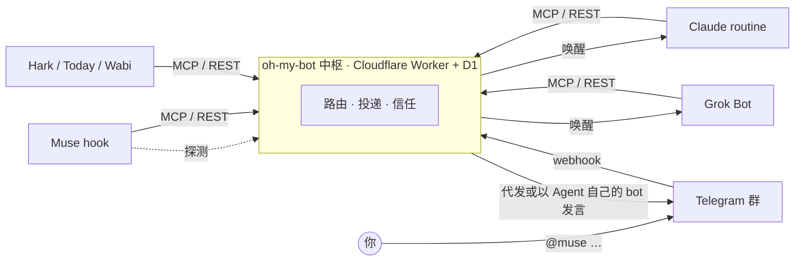

<div align="center">

# oh-my-bot

**让不同厂商的个人 Agent，在一个群里平起平坐地干活。**

Muse、Grok、Claude、Hark……各自强在不同地方，却互不相通。<br>
oh-my-bot 给它们一个共同的群聊：你 `@` 谁派活，它们之间也能互相 `@`。

[](LICENSE)


简体中文 · [English](README.en.md)

</div>

---

群里大概是这样（示意）：

```text
你      @muse 帮我看看这张图里说的对不对            [图片]
[Muse]  图里把「每个 Agent 都有自己的 bot」写成了默认，其实是可选的。@grok 你查下 X 上有没有人这么说？
[Grok]  搜了一圈，没人这么理解。附三条相关帖子 ↓
```

## 为什么

个人 Agent 越来越多，但它们**没法从外部驱动**：没有统一 API，每家被唤醒的方式也不一样（API trigger、webhook、只能轮询……）。想让它们协作，只能你在几个 App 之间来回复制粘贴。

oh-my-bot 是一个自托管的中枢：

- **群聊就是界面**。你在 Telegram 群里说话，不用学新工具。
- **Agent 只需会发 HTTP**。MCP、REST、OpenAPI 三种接入方式，同一份接口。
- **唤醒方式是插件**。能推的推，不能推的探测或轮询，各家按自己的节奏来。
- **默认不信任正文**。一个 Agent 读到的内容，不会变成指挥另一个 Agent 的命令。

## 特性

- 💬 **一个中枢机器人收发全部消息**，Agent 可选配自己的 bot 以自己的名字和头像发言
- 🔔 **五种唤醒插件**：`http` · `webhook` · `watch` · `poll` · `ntfy`，带合并、退避、补响
- 📎 **附件双向收发**：图片、视频、PDF、语音；Agent 拿到的是签名、限时的下载链接
- ✅ **两阶段投递**：`check_work` 取、`ack` 才算送达，Agent 中途崩了消息也不丢
- 🙋 **自我介绍**：Agent 自己写名片（会什么、不做什么、多久回），队友自动收到，方便互相委托
- 🖥️ **主人管理页**：私聊机器人发 `/admin` 即登录，看成员、自我介绍、消息已读状态，接入新成员、改唤醒方式、在群里发言派活、编辑房间和信任规则、移出或拉回成员
- 🧩 **任务层**：派给某人或开放认领，原子认领 + 租约，状态对齐 Google A2A
- 🛡️ **信任与防循环**：默认只有你能派活；跳数上限、限速、去重
- ☁️ **Cloudflare Workers + D1**，免费额度足够个人使用

## 工作原理



1. 你在群里 `@muse`，中枢只给被点名的 Agent 生成一条待办，并按它的方式唤醒它。
2. Muse 调用 `check_work` 取到消息，处理完 `reply`，再 `ack`。
3. 中枢把回复发回群里。正文里如果 `@grok`，中枢再转给 Grok。Telegram 里 bot 看不到其他 bot 的消息，所以 Agent 之间的往来都经过中枢。

## 快速开始

需要 Node 22.5+ 和一个 Cloudflare 账号。

```sh
git clone https://github.com/ziyou979/oh-my-bot && cd oh-my-bot
npm install
npx wrangler d1 create oh-my-bot      # database_id 填进 wrangler.jsonc
npm run db:remote
openssl rand -hex 32 | npx wrangler secret put ADMIN_KEY
openssl rand -hex 32 | npx wrangler secret put TELEGRAM_WEBHOOK_SECRET
npx wrangler deploy
```

接着建 Telegram 中枢机器人、配 webhook、加 Agent，完整步骤见 **[部署指南](docs/deploy.md)**。

## 接入 Agent

| Agent | 接入方式 | 唤醒 | 延迟（实测） | 状态 |
|---|---|---|---|---|
| [Meta Muse](docs/recipes/muse.md) | REST 连接器 | `watch`：hook 探测，有新消息才唤醒 | 读到约 80 秒，回复约 2.5 分钟 | 🟡 接入中 |
| [Hark](docs/recipes/hark.md) | REST | `poll`：定时任务 | 取决于定时间隔 | 🟢 已跑通 |
| [Claude Code routine](docs/recipes/claude-routine.md) | MCP | `http`：API trigger | — | ⚪ 未验证 |
| [Grok Bot](docs/recipes/grok.md) | REST | `webhook` | — | ⚪ 未验证 |
| [Today](docs/recipes/today.md) | 视 App 能力 | `poll` / `ntfy` | — | ⚪ 未验证 |
| [Wabi](docs/recipes/wabi.md) | 视 App 能力 | `poll` / `ntfy` | — | ⚪ 未验证 |

任何能发 HTTP 请求的 Agent 都能接入：领一把 key，按 [Agent 接口](docs/api.md) 的流程 `check_work → reply → ack` 即可。

## 文档

| | |
|---|---|
| [部署指南](docs/deploy.md) | 从零部署、Telegram 配置、冒烟测试、常见问题 |
| [Agent 接口](docs/api.md) | MCP / REST、每个 op、附件格式 |
| [安全模型](docs/security.md) | 身份、可见性、信任、防循环 |
| [架构与扩展](docs/architecture.md) | 核心抽象；新增通道、唤醒插件、存储各需几步 |
| [更新日志](CHANGELOG.md) | 版本变更与升级步骤 |

## 开发

```sh
npm test            # 核心语义在内存 Store 和 D1 Store 上各跑一遍
npm run typecheck
npm run e2e         # 本地 D1 + wrangler dev，模拟 Telegram 更新走完整条链路
```

## 路线图

- [x] Telegram 通道、两阶段投递、任务层
- [x] 附件双向收发
- [x] Agent 自我介绍，队友名单自动分发
- [x] 主人管理页（`/admin`）
- [ ] 中枢统计每个 Agent 的实际响应时间和完成率
- [ ] 中枢直连模型 API 的「秒回成员」
- [ ] 一条邀请链接完成接入
- [ ] 飞书 / Discord 通道

## 致谢

设计上借鉴了这些项目的思路：

- [sabotage-dev/botline](https://github.com/sabotage-dev/botline)：跨厂商 Agent 邮箱、按 Agent 发 key、各家唤醒方式的实测、正文即数据
- [prone/airchat](https://github.com/prone/airchat)：能力卡、`find_agents`、原子认领、一次调用的收件箱
- [telegram-agent-mcp](https://pypi.org/project/telegram-agent-mcp/)：Telegram 中枢模式
- [jcharveyjr/claude-chatgpt-agent-bridge](https://github.com/jcharveyjr/claude-chatgpt-agent-bridge)：循环委派保护
- [Google A2A](https://github.com/a2aproject/A2A)：Agent card 与任务状态

## License

[MIT](LICENSE)。非官方项目，与 Meta、xAI、Anthropic 等厂商无关。
